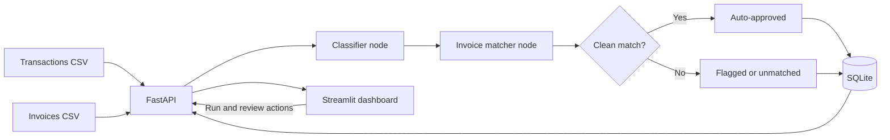

# FinAudit AI

FinAudit AI is a local financial reconciliation demo. It classifies bank
transactions, matches them to invoices, flags discrepancies for human review,
and stores reconciliation and review decisions in SQLite. A Streamlit dashboard
provides the operator view; FastAPI remains the source of reconciliation logic
and data.

## Tech stack

- **Python** for the app and domain models
- **FastAPI** for the local HTTP API
- **Pydantic** for transaction, invoice, and match-result validation
- **LangGraph** for classification, matching, and conditional routing
- **SQLite** for durable reconciliation and review status
- **Streamlit** for the dashboard
- **CSV** for the sample transaction and invoice inputs

## Architecture



## Requirements and setup

Use Python 3.10 or newer. From the project root, run these PowerShell commands:

```powershell
python -m venv .venv
.\.venv\Scripts\Activate.ps1
python -m pip install -r requirements.txt
python generate_sample_data.py
```

The CSV inputs are written to `data/transactions.csv` and `data/invoices.csv`.
The API creates `data/finaudit.db` on startup. CSV inputs and SQLite databases
are local data and are excluded from Git.

## Start the local demo

Open two terminals at the project root and activate the virtual environment in
each. In Terminal 1, start FastAPI:

```powershell
.\.venv\Scripts\Activate.ps1
uvicorn app.main:app --reload
```

The API health check is `http://127.0.0.1:8000/health`; interactive docs are at
`http://127.0.0.1:8000/docs`.

In Terminal 2, start Streamlit:

```powershell
.\.venv\Scripts\Activate.ps1
streamlit run dashboard.py
```

Open the local URL printed by Streamlit, usually `http://localhost:8501`. The
sidebar defaults to the API at `http://127.0.0.1:8000`. On the Review queue page,
enter a reviewer name before approving or rejecting a pending result.

## Demo workflow

1. Select **Run reconciliation** on the Overview page.
2. Review the summary metrics and saved match table. Amount differences at or
   below 2% are auto-approved; larger differences and missing invoices enter
   the review queue.
3. Open **Review queue**, enter a reviewer name, and approve or reject a record.
4. The queue refreshes after the action. The result table shows the decision,
   reviewer, and review status.

The sample dataset used for local verification produced 80 reconciliation
results: 51 auto-approved and 29 initially awaiting review. An approval and a
rejection reduced the pending queue from 29 to 27, and both decisions were
confirmed through the API and a direct read of the SQLite database.

## Screenshots

**Dashboard overview**


**Reconciliation results**


## API endpoints

| Method | Path | Purpose |
| --- | --- | --- |
| `GET` | `/health` | Health check |
| `GET` | `/transactions` | Load transactions from CSV |
| `GET` | `/invoices` | Load invoices from CSV |
| `POST` | `/run-reconciliation` | Run the graph and persist results |
| `GET` | `/reconciliation-results` | List all saved match results |
| `GET` | `/transactions/flagged` | List records awaiting review |
| `POST` | `/transactions/{transaction_id}/approve` | Approve a pending record |
| `POST` | `/transactions/{transaction_id}/reject` | Reject a pending record |

Review requests use JSON such as `{"reviewed_by":"Alex Reviewer"}`. Missing
results return `404`, already reviewed results return `409`, and invalid
reviewer values return `422`. Reconciliation reruns preserve human decisions.

## Tests

Run the backend test suite from the project root:

```powershell
python -m unittest discover -s tests -v
```

Tests cover the 2% threshold, discrepancies, unmatched transactions, conditional
graph routing, API review behavior, and SQLite persistence.
