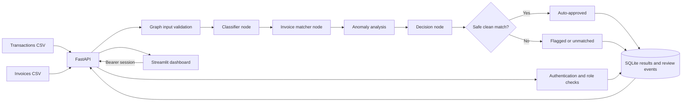
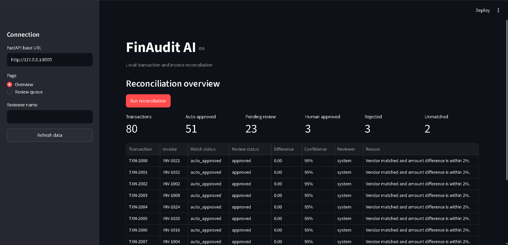
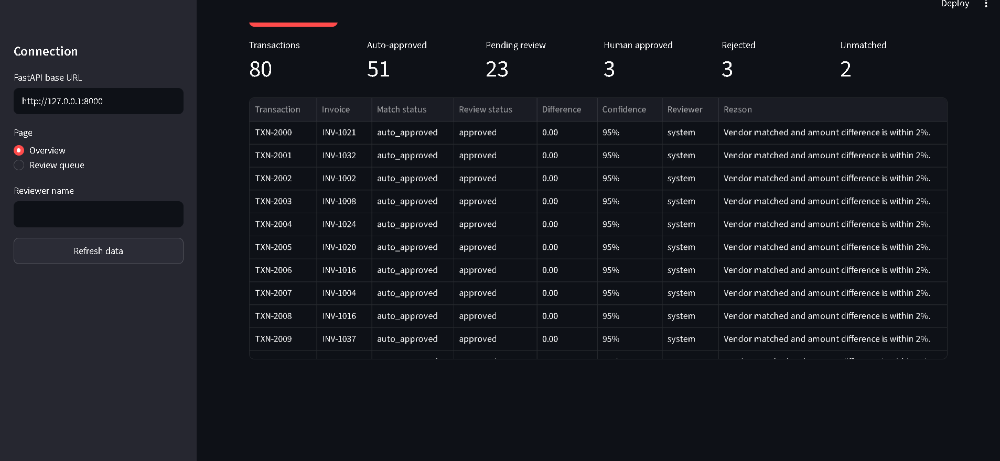

# FinAudit AI

FinAudit AI is a local financial reconciliation demo. It validates transaction
and invoice CSV rows, deterministically links transactions to invoice
candidates, explains discrepancies and anomalies, and stores reconciliation
and human review decisions in SQLite. A Streamlit dashboard provides the
operator view; FastAPI remains the source of reconciliation logic and data.

## Tech stack

- **Python** for the app and domain models
- **FastAPI** for the local HTTP API
- **Pydantic** for transaction, invoice, and match-result validation
- **LangGraph** for classification, matching, and conditional routing
- **SQLite** for durable reconciliation and review status
- **Python standard library** for PBKDF2 password hashes and opaque sessions
- **Streamlit** for the dashboard
- **CSV** for the sample transaction and invoice inputs

## Architecture



## Requirements and setup

Use Python 3.10 or newer. From the project root, run these PowerShell commands:

```powershell
python -m venv .venv
.\.venv\Scripts\Activate.ps1
python -m pip install -r requirements.txt
python generate_sample_data.py
```

The CSV inputs are written to `data/transactions.csv` and `data/invoices.csv`.
The API creates `data/finaudit.db` on startup. CSV inputs and SQLite databases
are local data and are excluded from Git.

Before the first API startup on a database without users, configure the
bootstrap administrator in the API terminal. Choose a unique password of at
least 12 characters. The variables create the first administrator only when
the database has no users. Changing them later does not reset an account or
create another one:

```powershell
$env:FINAUDIT_BOOTSTRAP_ADMIN_USERNAME = "admin"
$env:FINAUDIT_BOOTSTRAP_ADMIN_PASSWORD = "replace-with-a-unique-password"
```

There is no default login. If both variables are unset on a database with no
users, the API starts with protected routes but no way to sign in until a
bootstrap admin is configured and the API is restarted. Do not commit real
credentials or put them in the README.

Optional matcher configuration uses these defaults:

```powershell
$env:FINAUDIT_AMOUNT_TOLERANCE = "0.02"
$env:FINAUDIT_DATE_TOLERANCE_DAYS = "7"
```

The amount value is a ratio (`0.02` means 2%); the date value is the maximum
absolute number of days between a transaction and invoice date. Both are
validated when the matcher loads. Currency codes currently supported by the
models are USD, EUR, GBP, INR, CAD, AUD, JPY, and CHF; omitted CSV currency
columns continue to default to USD. Set `FINAUDIT_API_URL` before starting the
dashboard if the API is listening at a non-default address.

## Start the local demo

Open two terminals at the project root and activate the virtual environment in
each. In Terminal 1, start FastAPI:

```powershell
.\.venv\Scripts\Activate.ps1
$env:FINAUDIT_BOOTSTRAP_ADMIN_USERNAME = "admin"
$env:FINAUDIT_BOOTSTRAP_ADMIN_PASSWORD = "replace-with-a-unique-password"
uvicorn app.main:app --reload
```

The API health check is `http://127.0.0.1:8000/health`; interactive docs are at
`http://127.0.0.1:8000/docs`.

In Terminal 2, start Streamlit:

```powershell
.\.venv\Scripts\Activate.ps1
streamlit run dashboard.py
```

Open the local URL printed by Streamlit, usually `http://localhost:8501`, and
sign in with the bootstrap administrator. Use **User management** to create
reviewer and auditor accounts. Reviewers process the queue; auditors can read
reconciliation results and review history without making changes.

## Demo workflow

1. As an administrator, create a reviewer and auditor account in **User
   management**, then sign out.
2. Sign in as the reviewer and select **Run reconciliation** on the Overview page.
3. Review the summary metrics, match outcome, anomaly, and saved match table.
   A fresh run on the included CSVs currently produces 80 results: 25
   auto-approved and 55 awaiting review. Counts depend on the CSV contents and
   matcher settings.
4. Open **Review queue**, optionally add a reason, and approve or reject a
   record. The API records the authenticated username and user ID from the
   session; a reviewer name is not accepted in the request body.
5. Confirm the queue refreshes, then open **Review history** to inspect the
   action, authenticated user, time, and reason.
6. Sign in as the auditor and confirm results and history remain readable while
   run and review actions are unavailable.

The 2% amount tolerance is only one part of the decision. Vendor identity,
dates, currencies, candidate ambiguity, duplicate invoice assignments, and
potential duplicate payments can all require review even when the amount is
within tolerance. Existing screenshots show the earlier MVP view; the current
dashboard also includes match outcomes and anomaly evidence.

## Screenshots

**Dashboard overview**



**Reconciliation results**



## API endpoints

| Method | Path | Purpose |
| --- | --- | --- |
| `GET` | `/health` | Public health check |
| `POST` | `/auth/login` | Exchange username and password for an 8-hour bearer session |
| `GET` | `/auth/me` | Return the authenticated user's identity and role |
| `POST` | `/auth/logout` | Revoke the current session |
| `GET` | `/transactions` | Read transactions (reviewer, auditor) |
| `GET` | `/invoices` | Read invoices (reviewer, auditor) |
| `POST` | `/run-reconciliation` | Run the graph (reviewer) |
| `GET` | `/reconciliation-results` | Read saved results (reviewer, auditor) |
| `GET` | `/transactions/flagged` | Read the pending queue (reviewer, auditor) |
| `GET` | `/transactions/{transaction_id}/review-history` | Read chronological history (reviewer, auditor) |
| `POST` | `/transactions/{transaction_id}/approve` | Approve a pending record (reviewer only) |
| `POST` | `/transactions/{transaction_id}/reject` | Reject a pending record (reviewer only) |
| `GET` | `/admin/users` | List accounts (admin only) |
| `POST` | `/admin/users` | Create an account and assign a role (admin only) |
| `PATCH` | `/admin/users/{user_id}` | Change role or enable/disable an account (admin only) |

Protected requests use `Authorization: Bearer <access_token>`. Approve/reject
requests accept an optional reason such as `{"reason":"Invoice verified."}`;
they do not accept a reviewer name. Missing results return `404`, already
reviewed results return `409`, unauthenticated requests return `401`, and
insufficient roles return `403`. Invalid request data returns `422`.

### Roles and sessions

- **Admin** can create, list, and update user accounts and roles. Admin has no
  reconciliation-data access or review permissions.
- **Reviewer** can read data and approve or reject pending results. For this
  MVP, the reviewer role deliberately also includes permission to run
  reconciliation.
- **Auditor** can read transactions, invoices, results, the pending queue, and
  review history. Business-data write actions are denied; signing out is
  available to every role.

Passwords use salted PBKDF2-HMAC-SHA256 hashes with 600,000 rounds. Sessions
are random opaque bearer tokens; only SHA-256 token digests are stored in
SQLite. Logout revokes a token, sessions expire after eight hours, and each
request reloads the user's active state and role so administrator changes take
effect immediately. The first administrator is created only from the bootstrap
environment variables described above. There is no public registration.

This MVP has no MFA, account recovery, or login rate limiting. Use it locally;
any remote deployment must use HTTPS and should add operational protections
before handling real financial data.

## Review history and integrity

SQLite schema version 2 added a separate `review_events` table. Each human
approval or rejection records an event ID, transaction ID, action, reviewer
identifier, UTC timestamp, optional reason, and previous/new review and match
statuses. The event insert and current result update run in one SQLite
transaction. If event persistence fails, the decision update rolls back.

Only `pending_review` can transition to `approved` or `rejected`. Repeated or
conflicting decisions return `409`; reopening a reviewed result is not
supported. Events are append-only through normal application operations, with
SQLite triggers rejecting updates and deletes. This is an application-level
audit history, not tamper-proof storage. Existing review decisions are retained
by the additive migration, but historical events are not fabricated for
decisions made before this feature existed.

The dashboard's **Review history** page shows action, authenticated username
and user ID, UTC timestamp, reason when supplied, and status transition. Events
created before Phase 4 have no user ID and display as legacy/unavailable. Their
old reviewer names were client-supplied values and are not retroactively
verified.

If a CSV contains malformed rows, duplicate identifiers, missing required
values, invalid dates, non-numeric/non-finite amounts, or an unsupported
currency, `/transactions`, `/invoices`, or `/run-reconciliation` returns HTTP
`422` with row numbers and validation reasons. A failed reconciliation does
not save a partial batch. Zero and negative monetary values are accepted so
legitimate adjustments are not silently discarded. Amounts are compared using
`Decimal` without rounding.

## Matching, evidence, and anomalies

Matching follows these rules:

1. When the transaction CSV has an `invoice_reference`, `invoice_number`,
   `reference`, or `invoice_id` column, an exact normalized reference to an
   invoice ID/number is considered first. The sample CSV has no such column;
   the loader does not invent references.
2. Otherwise, vendor identity is normalized for Unicode compatibility, case,
   punctuation, and repeated whitespace.
3. A candidate within the configurable amount tolerance is preferred, followed
   by date agreement within the configured day window and currency agreement.
4. A unique best candidate may be selected. Equally plausible candidates are
   returned as ambiguous without assigning an invoice. Each invoice is
   assigned to at most one transaction in a reconciliation run.

Match outcomes include exact/probable match, amount/date/currency/vendor
mismatch, missing invoice, ambiguous candidates, duplicate invoice, potential
duplicate payment, and invalid input. Anomalies are separate structured items
with severity, evidence, explanation, recommended action, and a human-review
flag. A potential duplicate is a review warning, not a claim of fraud. The
current potential-payment rule identifies the same normalized vendor, exact
amount and currency, within three days of a prior transaction.

The CSV loader also accepts optional transaction reference and currency
columns, plus an optional invoice currency or `paid` column. Invoice `paid`
values accept `true`/`false`, `yes`/`no`, and `1`/`0`; a paid invoice candidate
is flagged as a potential duplicate payment.

Confidence is a deterministic evidence score from 0 to 1, not a calibrated
probability and not the final decision. The score is the weighted mean of
available evidence components, rounded to four decimal places, minus `0.08`
for each anomaly up to `0.40`. Component weights are reference `3`, vendor `3`,
amount `3`, date `1`, currency `1`, and uniqueness `2`. Agreement contributes
1, conflict contributes 0, and amount/date agreement can contribute partial
values based on their configured tolerance. Unavailable reference evidence is
omitted from the weighted mean. An anomaly or hard matching conflict still
requires review regardless of score.

The SQLite schema is upgraded additively on API startup using
`PRAGMA user_version`; migration version 1 adds match outcome, evidence, and
anomaly columns, version 2 adds review-event history, and version 3 adds users,
hashed-token sessions, and authenticated reviewer IDs on new events. Existing
rows, review decisions, and review events remain intact. Existing CSV files
stay backward-compatible.
Partial payments and split settlements are not supported in this phase.

The LangGraph workflow validates input, classifies the transaction, matches an
invoice, analyzes result consistency and anomalies, decides whether it is
eligible for auto-approval, and routes to the clean or review path. Validation,
classification, matching, analysis, and decision failures fail closed. A clean
route requires a unique invoice, matching vendor/currency/date evidence, an
amount within tolerance, no anomaly warnings, and a second safety check in the
API before system approval. Incomplete results are kept for human review when a
valid transaction identifier is available.

## Evaluation

Run the curated evaluation from the project root:

```powershell
python -m evaluation.run_evaluation
```

The scenario inputs are in `evaluation/dataset/transactions.csv` and
`invoices.csv`; expected outcomes are kept separately in `labels.csv`. Every
label has a stable `scenario_id` and `transaction_id`. The runner rejects blank
or duplicate IDs and requires an exact one-to-one match between transaction
inputs and labels before running predictions. It also rejects blank or duplicate
invoice IDs and labels that reference a nonexistent invoice. Expected labels are not inferred
from predictions. The runner calls the existing reconciliation endpoint
function and writes to a temporary SQLite database that is removed after the
run. It calls the endpoint function directly with a reviewer principal;
authentication and RBAC are covered separately by the API tests. The runner
also submits the malformed-input fixture and checks that the expected rows are
rejected without changing the saved results.

Metric definitions use one labelled transaction as a case. A correct invoice
match is an exact predicted `invoice_id` match to a non-empty expected invoice
ID. A wrong non-empty invoice assignment contributes one false positive and one
false negative; an expected and predicted absence of a unique invoice is a true
negative. Match precision is TP/(TP+FP), and recall is TP/(TP+FN). Anomaly
metrics treat each `(transaction_id, anomaly_type)` pair as one label and use
the same TP/FP/FN formulas. False auto-approval counts predictions with status
`auto_approved` when the expected status is not `auto_approved` or the predicted
invoice ID is wrong; its rate denominator is all predicted auto-approvals.
Status and outcome accuracy are exact label agreement divided by case count.
Manual-review rate is the number of `pending_review` results divided by case
count. Processing failures count each result once when its outcome is
`invalid_input` or it has a `processing_error`/`invalid_input` anomaly; the rate
denominator is case count. CSV validation rejections are reported separately
from per-transaction processing failures. Every rate reports its numerator and
denominator; a zero denominator produces `percent: null` rather than a
misleading zero percent.

This is a small hand-labelled smoke benchmark covering exact matches, vendor
punctuation and case variation, amount discrepancies, duplicate payments, tied
invoice candidates, an unmatched vendor, missing required fields, and malformed
amount input. Existing fail-closed workflow tests cover graph exceptions and
incomplete outputs; the evaluator's error metric is also tested with a synthetic
processing-error result. Its percentages describe these curated cases only;
they are not a statistically representative estimate of production
performance. The expected labels are curated with these fixtures, not
independently adjudicated or held out; exact-reference scenarios intentionally
use the transaction's reference field, so this set is not a blind benchmark.

### Independent label review

Generate a reviewer worksheet without prediction columns:

```powershell
python -m evaluation.review_labels
```

This writes `evaluation/dataset/label-review.csv` from the stable scenario IDs,
separate labels, and input files. Every row is explicitly marked
`independently_reviewed=no` and `reviewer_status=pending`. A reviewer should
compare the transaction and invoice inputs with the documented business rules,
record their status and any disagreement, and keep system predictions out of
the blind review copy. Resolve disagreements by documenting the evidence and
changing labels only after agreement; retain the prior file in version history.
The worksheet is a review aid, not proof that independent review occurred.

## Tests

Run the backend test suite from the project root:

```powershell
python -m unittest discover -s tests -v
```

Tests use synthetic fixtures and temporary databases. They cover exact
references, vendor normalization, amount/date/currency comparisons, zero and
negative amounts, ambiguous and duplicate invoices, potential duplicate
payments, CSV row errors, one-to-one assignment, confidence scoring, additive
migration, review persistence across reruns, fail-closed graph exceptions,
ambiguous/duplicate routing, review-event migrations and persistence, atomic
review rollback, review-state conflicts, password hashing, login/logout,
session expiry, role authorization, admin account management, authenticated
audit attribution, dashboard login, dashboard history, evaluation metric
definitions, exact label coverage, processing-error metrics, labelled
acceptance scenarios, and all original tests.
