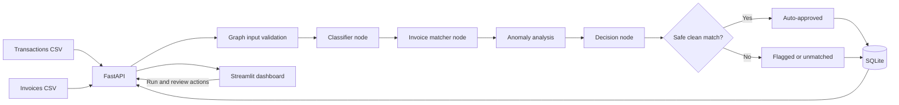

# FinAudit AI

FinAudit AI is a local financial reconciliation demo. It validates transaction
and invoice CSV rows, deterministically links transactions to invoice
candidates, explains discrepancies and anomalies, and stores reconciliation
and human review decisions in SQLite. A Streamlit dashboard provides the
operator view; FastAPI remains the source of reconciliation logic and data.

## Tech stack

- **Python** for the app and domain models
- **FastAPI** for the local HTTP API
- **Pydantic** for transaction, invoice, and match-result validation
- **LangGraph** for classification, matching, and conditional routing
- **SQLite** for durable reconciliation and review status
- **Streamlit** for the dashboard
- **CSV** for the sample transaction and invoice inputs

## Architecture



## Requirements and setup

Use Python 3.10 or newer. From the project root, run these PowerShell commands:

```powershell
python -m venv .venv
.\.venv\Scripts\Activate.ps1
python -m pip install -r requirements.txt
python generate_sample_data.py
```

The CSV inputs are written to `data/transactions.csv` and `data/invoices.csv`.
The API creates `data/finaudit.db` on startup. CSV inputs and SQLite databases
are local data and are excluded from Git.

Optional matcher configuration uses these defaults:

```powershell
$env:FINAUDIT_AMOUNT_TOLERANCE = "0.02"
$env:FINAUDIT_DATE_TOLERANCE_DAYS = "7"
```

The amount value is a ratio (`0.02` means 2%); the date value is the maximum
absolute number of days between a transaction and invoice date. Both are
validated when the matcher loads. Currency codes currently supported by the
models are USD, EUR, GBP, INR, CAD, AUD, JPY, and CHF; omitted CSV currency
columns continue to default to USD. Set `FINAUDIT_API_URL` before starting the
dashboard if the API is listening at a non-default address.

## Start the local demo

Open two terminals at the project root and activate the virtual environment in
each. In Terminal 1, start FastAPI:

```powershell
.\.venv\Scripts\Activate.ps1
uvicorn app.main:app --reload
```

The API health check is `http://127.0.0.1:8000/health`; interactive docs are at
`http://127.0.0.1:8000/docs`.

In Terminal 2, start Streamlit:

```powershell
.\.venv\Scripts\Activate.ps1
streamlit run dashboard.py
```

Open the local URL printed by Streamlit, usually `http://localhost:8501`. The
sidebar defaults to the API at `http://127.0.0.1:8000`. On the Review queue page,
enter a reviewer name before approving or rejecting a pending result.

## Demo workflow

1. Select **Run reconciliation** on the Overview page.
2. Review the summary metrics, match outcome, anomaly, and saved match table.
   A fresh run on the included CSVs currently produces 80 results: 25
   auto-approved and 55 awaiting review. Counts depend on the CSV contents and
   matcher settings.
3. Open **Review queue**, enter a reviewer name, and approve or reject a record.
4. The queue refreshes after the action. The result table shows the decision,
   reviewer, and review status.

The 2% amount tolerance is only one part of the decision. Vendor identity,
dates, currencies, candidate ambiguity, duplicate invoice assignments, and
potential duplicate payments can all require review even when the amount is
within tolerance. Existing screenshots show the earlier MVP view; the current
dashboard also includes match outcomes and anomaly evidence.

## Screenshots

**Dashboard overview**


**Reconciliation results**


## API endpoints

| Method | Path | Purpose |
| --- | --- | --- |
| `GET` | `/health` | Health check |
| `GET` | `/transactions` | Load transactions from CSV |
| `GET` | `/invoices` | Load invoices from CSV |
| `POST` | `/run-reconciliation` | Run the graph and persist results |
| `GET` | `/reconciliation-results` | List all saved match results |
| `GET` | `/transactions/flagged` | List records awaiting review |
| `POST` | `/transactions/{transaction_id}/approve` | Approve a pending record |
| `POST` | `/transactions/{transaction_id}/reject` | Reject a pending record |

Review requests use JSON such as `{"reviewed_by":"Alex Reviewer"}`. Missing
results return `404`, already reviewed results return `409`, and invalid
reviewer values return `422`. Reconciliation reruns preserve human decisions.

If a CSV contains malformed rows, duplicate identifiers, missing required
values, invalid dates, non-numeric/non-finite amounts, or an unsupported
currency, `/transactions`, `/invoices`, or `/run-reconciliation` returns HTTP
`422` with row numbers and validation reasons. A failed reconciliation does
not save a partial batch. Zero and negative monetary values are accepted so
legitimate adjustments are not silently discarded. Amounts are compared using
`Decimal` without rounding.

## Matching, evidence, and anomalies

Matching follows these rules:

1. When the transaction CSV has an `invoice_reference`, `invoice_number`,
   `reference`, or `invoice_id` column, an exact normalized reference to an
   invoice ID/number is considered first. The sample CSV has no such column;
   the loader does not invent references.
2. Otherwise, vendor identity is normalized for Unicode compatibility, case,
   punctuation, and repeated whitespace.
3. A candidate within the configurable amount tolerance is preferred, followed
   by date agreement within the configured day window and currency agreement.
4. A unique best candidate may be selected. Equally plausible candidates are
   returned as ambiguous without assigning an invoice. Each invoice is
   assigned to at most one transaction in a reconciliation run.

Match outcomes include exact/probable match, amount/date/currency/vendor
mismatch, missing invoice, ambiguous candidates, duplicate invoice, potential
duplicate payment, and invalid input. Anomalies are separate structured items
with severity, evidence, explanation, recommended action, and a human-review
flag. A potential duplicate is a review warning, not a claim of fraud. The
current potential-payment rule identifies the same normalized vendor, exact
amount and currency, within three days of a prior transaction.

The CSV loader also accepts optional transaction reference and currency
columns, plus an optional invoice currency or `paid` column. Invoice `paid`
values accept `true`/`false`, `yes`/`no`, and `1`/`0`; a paid invoice candidate
is flagged as a potential duplicate payment.

Confidence is a deterministic evidence score from 0 to 1, not a calibrated
probability and not the final decision. The score is the weighted mean of
available evidence components, rounded to four decimal places, minus `0.08`
for each anomaly up to `0.40`. Component weights are reference `3`, vendor `3`,
amount `3`, date `1`, currency `1`, and uniqueness `2`. Agreement contributes
1, conflict contributes 0, and amount/date agreement can contribute partial
values based on their configured tolerance. Unavailable reference evidence is
omitted from the weighted mean. An anomaly or hard matching conflict still
requires review regardless of score.

The SQLite schema is upgraded additively on API startup using
`PRAGMA user_version`; migration version 1 adds match outcome, evidence, and
anomaly columns. Existing rows and review decisions receive legacy defaults
and remain intact. Existing CSV files stay backward-compatible. Partial
payments and split settlements are not supported in this phase.

The LangGraph workflow validates input, classifies the transaction, matches an
invoice, analyzes result consistency and anomalies, decides whether it is
eligible for auto-approval, and routes to the clean or review path. Validation,
classification, matching, analysis, and decision failures fail closed. A clean
route requires a unique invoice, matching vendor/currency/date evidence, an
amount within tolerance, no anomaly warnings, and a second safety check in the
API before system approval. Incomplete results are kept for human review when a
valid transaction identifier is available.

## Tests

Run the backend test suite from the project root:

```powershell
python -m unittest discover -s tests -v
```

Tests use synthetic fixtures and temporary databases. They cover exact
references, vendor normalization, amount/date/currency comparisons, zero and
negative amounts, ambiguous and duplicate invoices, potential duplicate
payments, CSV row errors, one-to-one assignment, confidence scoring, additive
migration, review persistence across reruns, fail-closed graph exceptions,
ambiguous/duplicate routing, and all original backend tests.
